# Knowledge Base Manager

Keep research, reading notes and project work in one Obsidian vault. Each library has its own folder, templates, checks and Git history. You can commit changes to one project while leaving the other libraries untouched. Start with an empty vault or register an existing library.

[简体中文使用指南](README.zh-CN.md)

## Install on desktop

Version `3.5.1` requires Obsidian desktop `1.15.1` or later. Install system Git for repository operations. The desktop plugin can run its bundled general checks on its own. Template-specific checks, approved edits to general rules and the offline CLI also require Node.js on your system `PATH`.

In **Settings → Community plugins → Browse**, search for **Knowledge Base Manager**, then select **Install** and **Enable**. You can also open the plugin from the [Obsidian community directory](https://community.obsidian.md/plugins/knowledge-base-manager).

To install manually from GitHub, use the files from a single release.

1. Open [GitHub Releases](https://github.com/psiQAQ/obsidian-kb-manager/releases/latest) and download `main.js`, `manifest.json`, and `styles.css` from **Assets**.
2. Create `<vault>/.obsidian/plugins/knowledge-base-manager/` and place all three files directly inside it. If your vault uses a custom configuration folder, substitute that folder for `.obsidian`.
3. Reload Obsidian and enable **Knowledge Base Manager** under **Settings → Community plugins**.

## Create, register, and use libraries

Run **Open knowledge base manager** from the command palette. Select **Create** in the sidebar to choose a template. Click any screenshot in this guide to open the full-size image.

| Manage three libraries in one vault | Choose a research template |
| --- | --- |
| [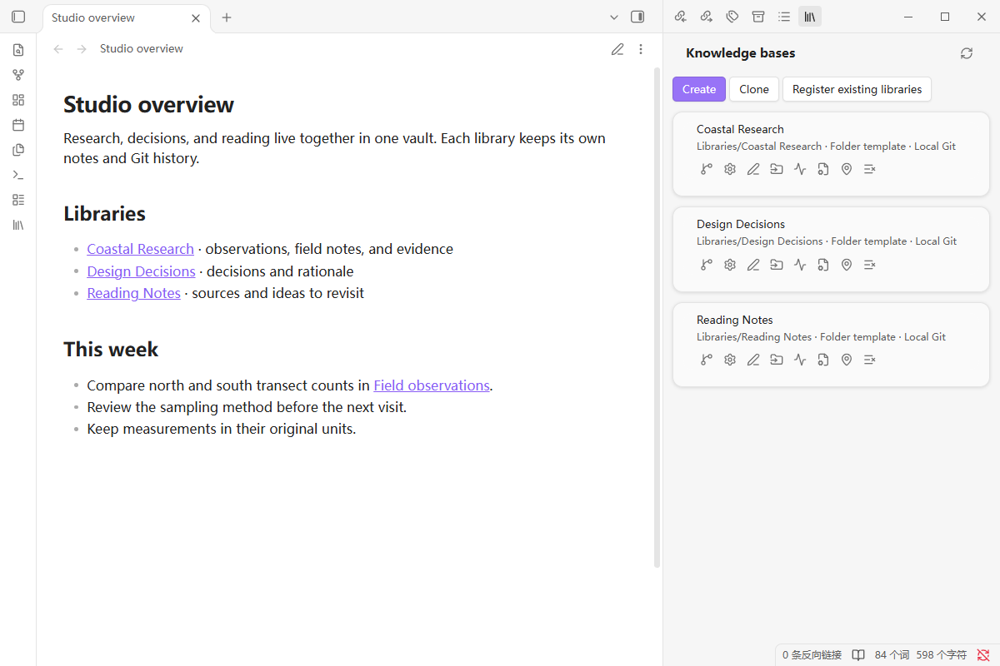](docs/screenshots/01-libraries-overview.png) | [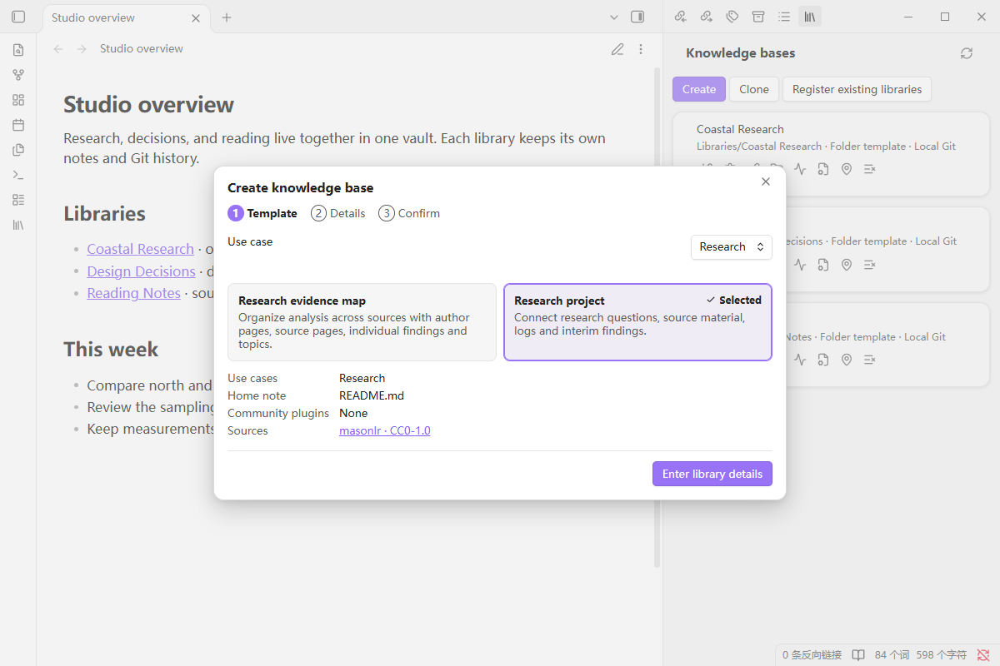](docs/screenshots/02-choose-research-template.png) |

1. Choose a use case and a template, then select **Enter library details**.
2. Choose a parent folder (the vault root is available) and enter the new folder name. Under **Advanced Git options**, check the name and email that will appear in commits. Leave the remote URL blank to work locally.
3. Select **Preview** to review the destination, initial commit and folders to hide from Obsidian search and graph. Excluding a folder can also hide its notes in Bases. Kepano leaves `Templates` visible by default so you can browse its template views. The preview also flags any diagnostic exclusion that points to a missing file or folder.
4. Select **Create library**. With the default settings, Git records `Initial commit` on `main` and includes the library’s offline runner. Select **Run first check** to see the results immediately. [First library walkthrough](docs/getting-started.md)

| Set the folder, display name and Git identity | Review the destination and search exclusions |
| --- | --- |
| [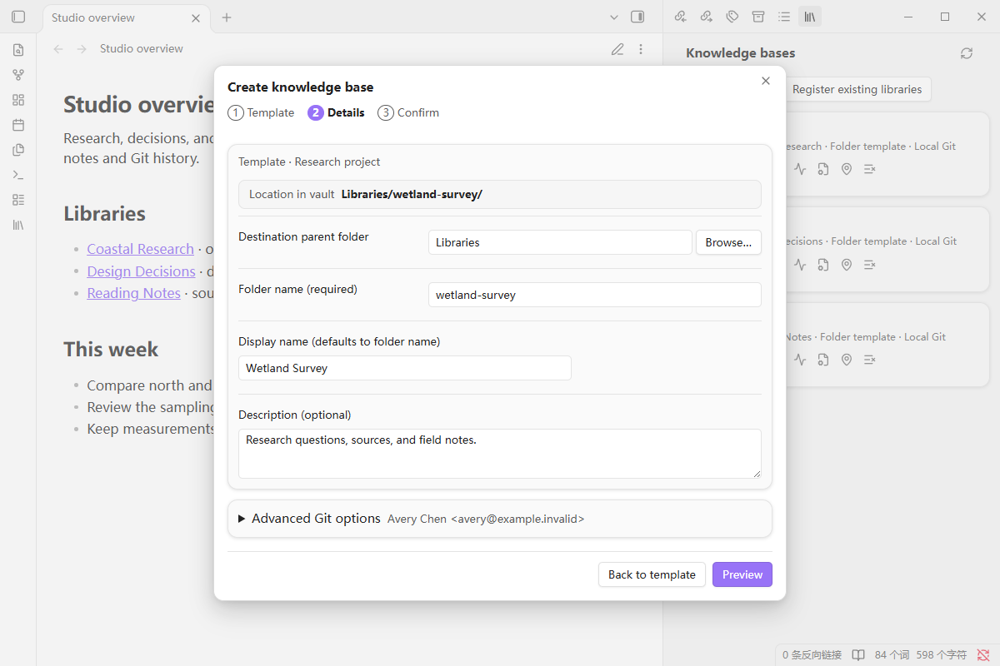](docs/screenshots/03-library-details.png) | [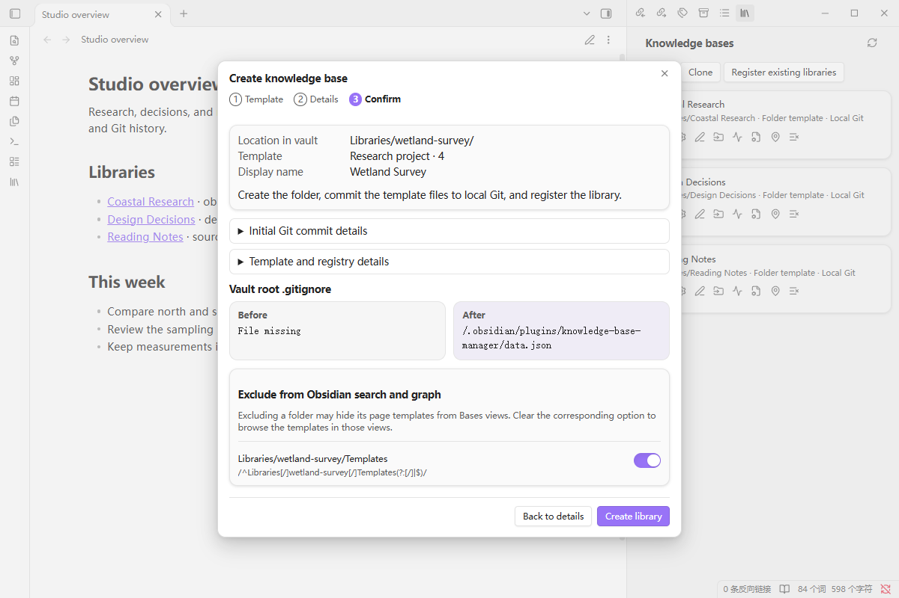](docs/screenshots/04-confirm-library-creation.png) |

Click a library card to open it. Hover over an icon to see its action. With a note from that library open, run **Insert library template** to preview the insertion. Existing note properties keep their values.

For an existing library, use **Register existing libraries** and select its `kb.toml` or scan a parent folder. Use **Clone** to bring in a remote repository. [Registration and recovery](docs/library-lifecycle.md)

### Choose a template

The 18 built-in templates cover nine use cases. Each entry below names the template, its stable ID and what its specialized check looks for. [Template sources and licenses](docs/template-catalog.md)

| Use case (`purpose`) | First template (`id` · default check) | Second template (`id` · default check) |
| --- | --- | --- |
| **Starter and daily notes** (`starter`) | **First week of notes** (`minimal-first-week` · daily entry and date) | **Journal and knowledge notes** (`minimal-journal` · note archive year) |
| **Collections** (`collections`) | **Kepano (with examples)** (`kepano` · category links) | **Media tracker** (`media-tracker` · media progress, ratings, and completion dates) |
| **Research** (`research`) | **Research project** (`research-project` · finding evidence) | **Research evidence map** (`research-evidence` · evidence source types) |
| **Reading** (`reading`) | **Zettelkasten** (`zettelkasten` · permanent note provenance) | **Topic reading and spaced review** (`domain-reading` · review card Q&A) |
| **Learning** (`learning`) | **Coursework** (`coursework` · valid courses and due dates) | **Exam practice and error review** (`exam-practice` · retry history for mastered items) |
| **Engineering and knowledge sharing** (`engineering`) | **Knowledge garden** (`knowledge-garden` · visibility and private references in shared notes) | **Technology radar** (`technology-radar` · adoption evidence and status) |
| **Projects and actions** (`projects`) | **Projects and weekly reviews** (`project-review` · open tasks before archiving) | **Action lists and GTD** (`gtd` · waiting item location and follow-up date) |
| **Writing and worldbuilding** (`writing`) | **Long-form manuscript** (`manuscript` · chapter numbering within a manuscript) | **Worldbuilding and timelines** (`worldbuilding` · event dates and locations) |
| **AI workflows** (`ai-workflows`) | **Integrated LLM Wiki** (`llm-wiki` · wiki index and analysis evidence) | **AI collaboration work log** (`ai-worklog` · decision supersession links) |

For example, Knowledge garden flags a private note marked as ready to share. Worldbuilding checks calendar dates such as `2026-02-30` while allowing fictional dates. You can also register a personal folder template or make one that declares its variables, managed files and checks in `kb-template.json`. [Template authoring guide](docs/template-authoring.md)

## Per-library Git workflow and history graph

Open **Git workspace** on a library card. In **Changes**, click a file to read its diff and stage a file or an individual hunk. If you stage a file and then edit it again, committing the staged changes saves the earlier snapshot. You can make a local commit before configuring a remote. [Git workflow, credentials and automation](docs/library-git.md)

| Inspect staged and working changes | Read a working tree diff side by side |
| --- | --- |
| [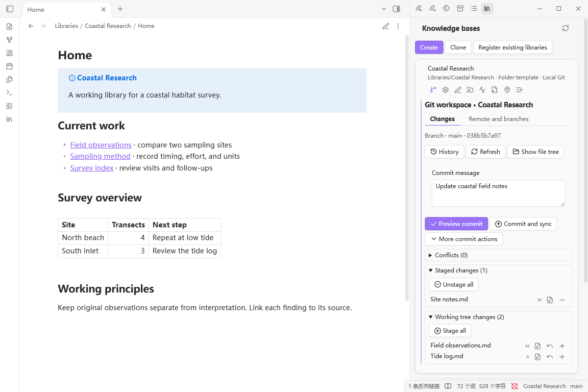](docs/screenshots/05-git-workspace.png) | [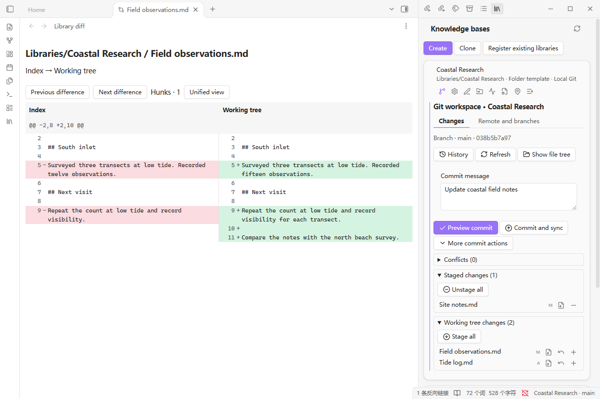](docs/screenshots/06-working-tree-diff.png) |

The commit preview shows which files will go into this commit. Here, only `Site notes.md` is staged. In the library’s Git settings, you can choose whether to stage files automatically when nothing is staged and set a message template for future commits.

| Review staged files before committing | Configure per-library commit defaults |
| --- | --- |
| [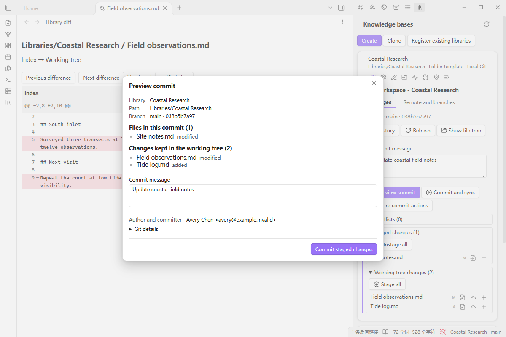](docs/screenshots/07-review-staged-commit.png) | [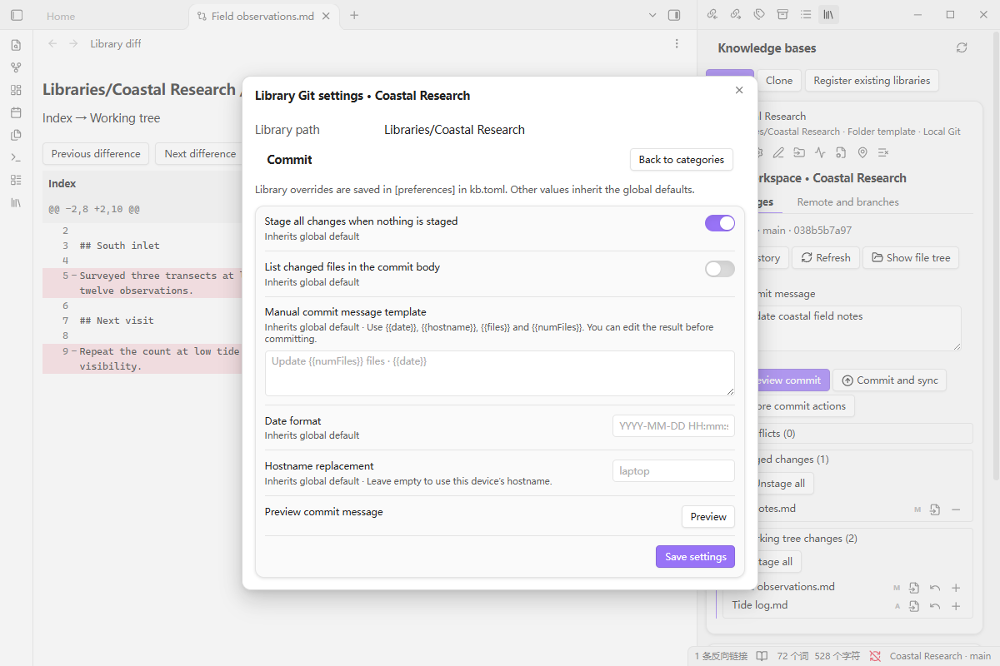](docs/screenshots/08-library-commit-settings.png) |

Open **History** and click a commit. By default, its metadata and changed files expand **under that row**. A merge opens against its first parent; you can select another parent. Click a file to open its red-and-green line diff, side by side or unified.

| Browse branch and merge history | Expand commit details inline |
| --- | --- |
| [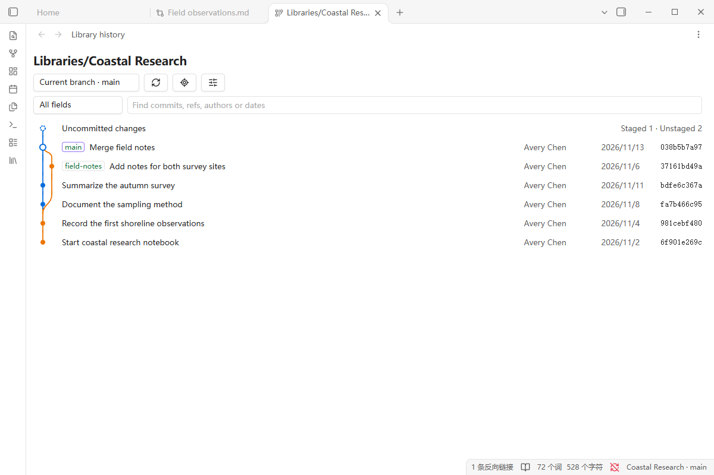](docs/screenshots/15-history-graph.png) | [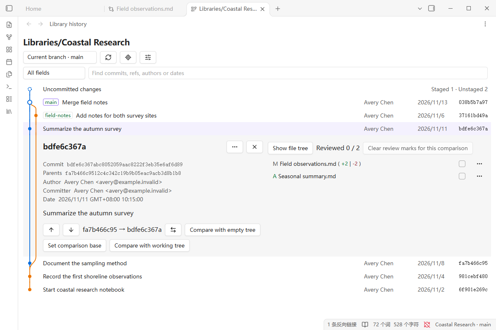](docs/screenshots/16-inline-commit-details.png) |

To compare two commits, click one, then **Ctrl-click** another (**Cmd-click** on macOS). The panel stays at the first row. The comparison runs from the lower row to the upper row; **Swap comparison direction** reverses it. Ctrl/Cmd-click a third row to change the comparison, or click the second again with the modifier to go back. Scroll down to load older commits, or press Ctrl/Cmd+F to search. [History graph controls](docs/git-graph-compatibility.md)

| Compare two selected commits | Inspect line diff between commits |
| --- | --- |
| [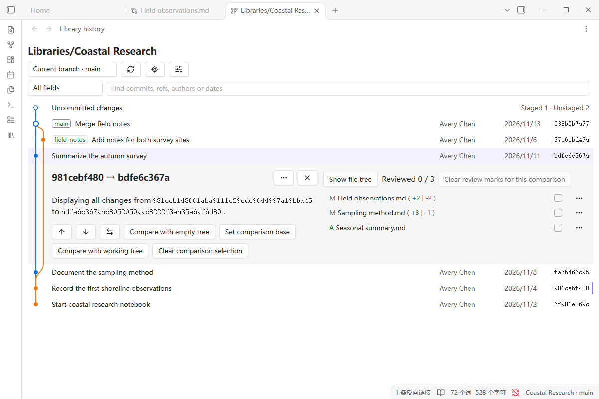](docs/screenshots/17-compare-two-commits.png) | [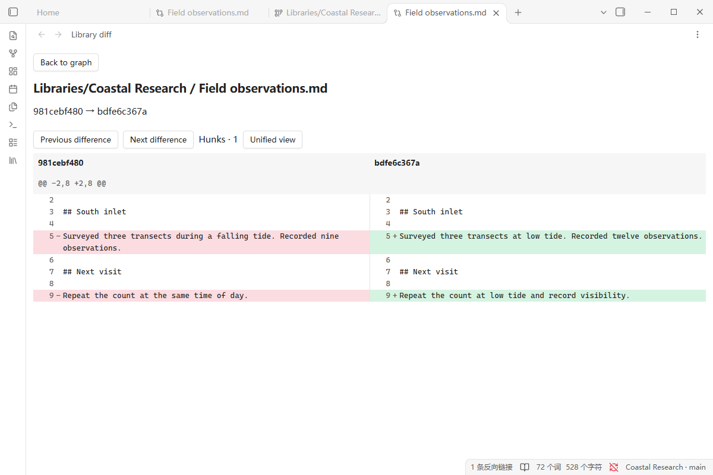](docs/screenshots/18-compare-commits-line-diff.png) |

## Check a library and run the offline CLI

On the library card, select **Check library → Start check** to run the general checks and template-specific rules. To see what would be left behind if you moved the library on its own, select **Choose individual checks → Portability**. Obsidian supplies the target it actually opens. By default, the same-name candidate search covers this library and other registered libraries; you can expand that search to the whole vault.

| Choose checks and optional portability checks | See what was checked, skipped or unverified |
| --- | --- |
| [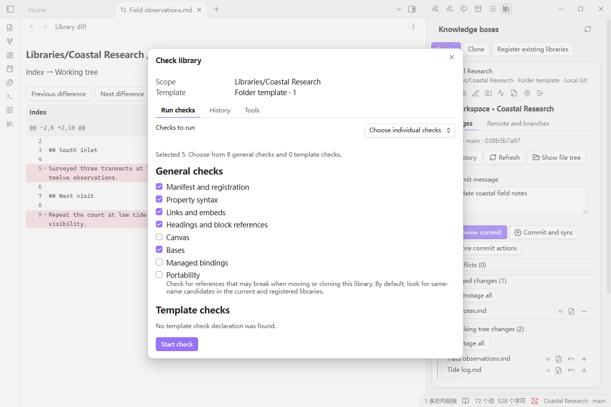](docs/screenshots/09-choose-diagnostic-checks.png) | [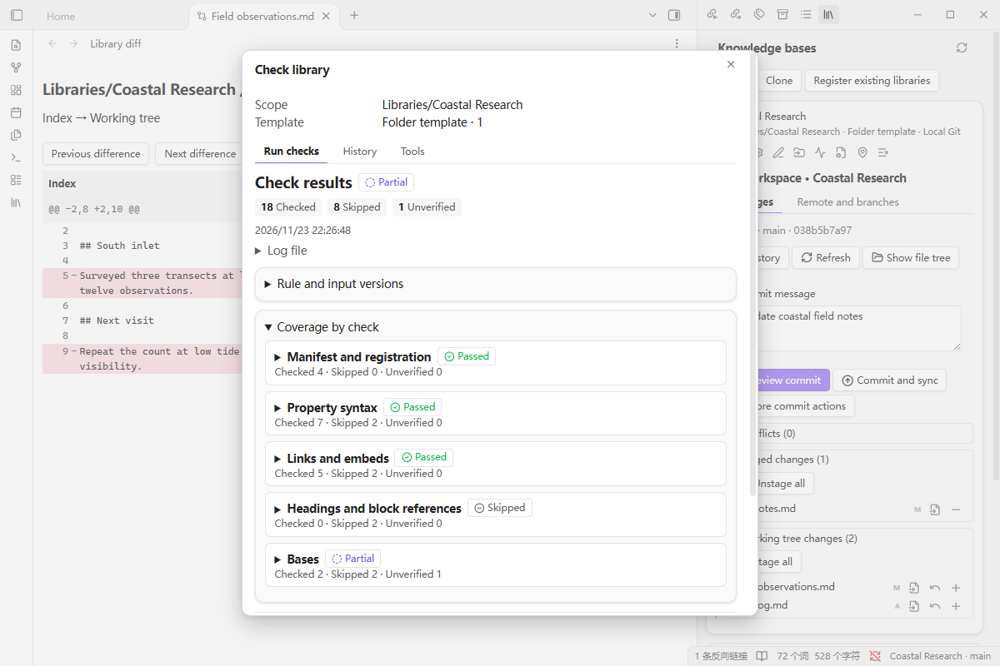](docs/screenshots/10-diagnostic-summary.png) |

Expand **Bases** under **Coverage by check** to see which files and filters were checked, skipped or left unverified. In the example below, click line 4 of `Views/Survey.base` to read the checked filter, `file.inFolder("Libraries/Coastal Research")`, in its source. A Base can have valid YAML while a dynamic filter still needs a check in Obsidian. A `partial` report can have zero findings.

| Inspect the folder filter checked in a Base | Open line 4 of Survey.base |
| --- | --- |
| [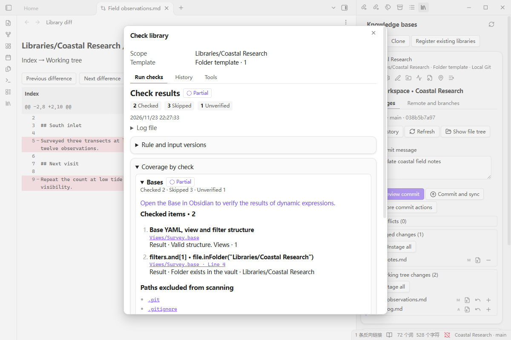](docs/screenshots/11-diagnostic-file-details.png) | [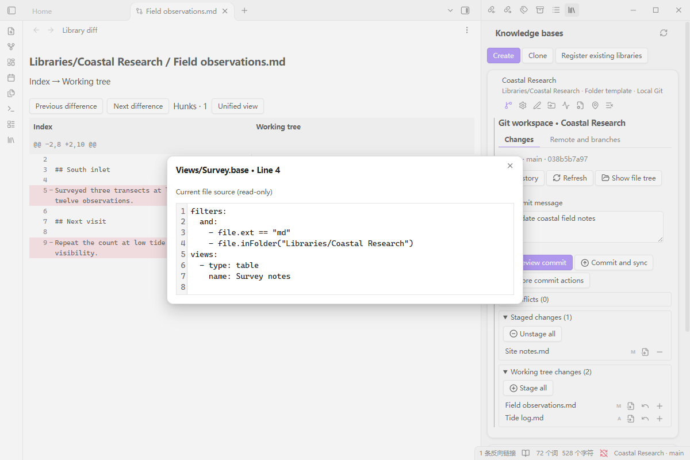](docs/screenshots/12-diagnostic-source-location.png) |

Template authors can set `diagnosticExclusions` in `kb-template.json` to skip selected checks for named source files or folders. Other notes linking **to** an excluded file still have their links checked. Obsidian’s search and graph exclusions are configured separately.

New libraries carry `checks/kb-check.cjs` and editable rules in `checks/common/`. In **Tools → Review version and changes**, you can update eligible files and inspect local edits for manual merging. Existing Kepano libraries can update `Attachments.base` and `Everything.base` individually. For a personal or edited rule, choose **Review script**, inspect its source and approve its SHA-256 fingerprint. An edit requires fresh approval. Older libraries without a runner can export one from **Tools**.

With Node.js installed, run these commands from the library root, even when Obsidian is closed:

```sh
node ./checks/kb-check.cjs --library . --list
node ./checks/kb-check.cjs --library . --checks all
```

`--checks all` runs the regular and template checks. To check portability separately, use `--checks portability` and pass `--vault-root` with the actual vault path. Offline runs may leave short links unverified. The CLI prints JSON and saves a report to `.log/`. Read `status`, each check’s `coverage` and its `diagnostics` together, even if the exit code is zero. [Checks, exit codes and log format](docs/diagnostics.md)

## Move or rename a library

Select **Move** on the library card, choose a destination and preview the change. To rename the library in place, keep its current parent and change the folder name.

The preview lists affected inbound links and recognizable path filters in standalone and embedded Bases, including views you created yourself. The right-hand screenshot shows the proposed rename and the Base paths you can update before you confirm. A relative link such as `[[../Course index]]` stays out of the preview if it will still open the same file. Review ambiguous links, unsaved edits and changes outside the library before confirming. Interrupted moves can be reviewed and resumed. [Moving a library](docs/library-lifecycle.md)

| Choose rename or move destination | Preview inbound links and Base path changes |
| --- | --- |
| [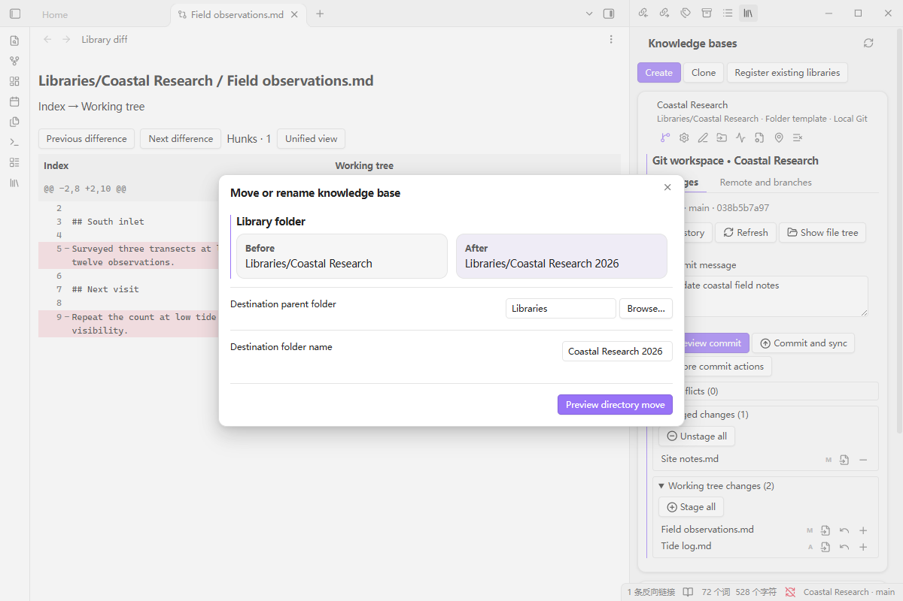](docs/screenshots/13-move-destination.png) | [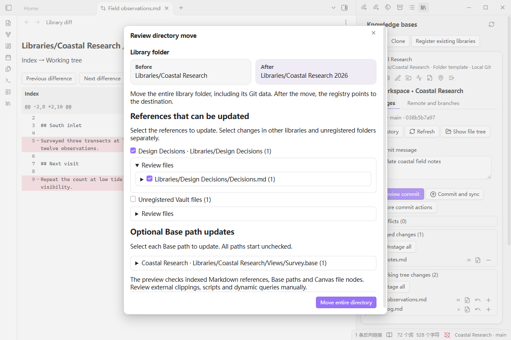](docs/screenshots/14-review-move-and-references.png) |

## Settings, storage, and privacy

| Where | What it holds or accesses |
| --- | --- |
| Plugin `data.json` | Language, default Git preferences and registered vault-relative library paths. Check whether this file is tracked before sharing a vault configuration. |
| Library and device settings | `kb.toml` stores the library’s UUID, template and per-library preferences. It is ignored by the library’s Git repository; keep it with the folder when moving it. Git identity and remotes use `.git/config`. Favorites, script approvals, automation grants and move recovery records stay on the device. Optional HTTPS fallback credentials use Obsidian SecretStorage. |
| Local files and processes | Desktop operations use filesystem APIs for library management, Git metadata and logs. Move previews inspect vault paths for affected inbound links. Git operations use system Git and can use OpenSSH for SSH remotes. Approved custom checks and template checks run in a local Node.js process with your account’s file and network permissions. |
| Network and clipboard | Clone, fetch, pull and push contact your chosen remote. Pushing shares commits and their authors. Automatic sync requires per-library authorization. Choosing a copy action in Git history writes the selected SHA, subject, reference or file path to the clipboard. |

## Build, verify, and contribute

Use Node.js 24, npm, system Git, and Python 3 in the repository root:

```sh
npm ci
npm run typecheck
npm run lint
npm test
npm run build
node scripts/verify-mobile.mjs
python scripts/package_plugin.py
```

The build produces `main.js` and `dist/kb-check.cjs`. The packaging script audits bundled dependencies and licenses and produces `dist/knowledge-base-manager.zip` with the plugin, CLI and notices. GitHub Releases distribute the three plugin files individually. CI validates the build on Windows, macOS and Ubuntu.

Detailed guides (in Simplified Chinese)

- [Getting started and first library walkthrough](docs/getting-started.md)
- [Per-library Git workflow and credentials](docs/library-git.md)
- [Desktop history graph and VS Code Git Graph comparison](docs/git-graph-compatibility.md)
- [Obsidian Git feature and command mapping](docs/git-compatibility.md)
- [Library lifecycle, registration, move, and recovery](docs/library-lifecycle.md)
- [Running and interpreting library diagnostics](docs/diagnostics.md)
- [Built-in template catalog and upstream credits](docs/template-catalog.md)
- [Template authoring and diagnostic script protocol](docs/template-authoring.md)
- [Build, verification, and platform support](docs/development.md)

<details>
<summary>Repository source and architecture guide</summary>

```text
obsidian-kb-manager/
├── manifest.json / versions.json / package.json / tsconfig.json / styles.css
├── esbuild.config.mjs               # Builds plugin main.js + standalone CLI dist/kb-check.cjs
├── src/
│   ├── main.ts                      # Desktop lifecycle, per-library mutex, commands, views
│   ├── settings.ts / preferences.ts / i18n.ts
│   ├── kb/                          # Catalog discovery, kb.toml identity, create/clone/move, bindings, check kit updates
│   ├── git/                         # Per-library native Git & isomorphic-git services, history graph, blame, hunks, sync
│   ├── diagnostics/                 # Shared diagnostic engine, bundled/Node common rules, template checks, CLI entry (cli.ts)
│   ├── fs/ & registry/              # Vault boundary validation, atomic writes, data.json registry & discovery
│   ├── ui/                          # Sidebar manager, wizards, Git workspace/history/diff tabs, health & script review dialogs
│   └── mobile/                      # Mobile entry split via Platform.isMobile (verified by verify-mobile.mjs; release isDesktopOnly)
├── assets/
│   ├── checks/common/*.mjs          # Distributed common check rules (manifest, properties, links, anchors, canvas, bases, bindings, portability)
│   ├── templates/<purpose>/<id>/    # 18 built-in templates across 9 categories (kb-template.json, checks/*.mjs, LICENSES.md)
│   └── licenses/obsidian-git.txt    # Upstream Obsidian Git MIT license notice
├── scripts/                         # template-catalog.mjs, build-check-kit.mjs, prepare-test-kit.mjs, verify-mobile.mjs, package_plugin.py
├── tests/                           # Node test runner suites (*.test.mjs) and isolated fixtures
├── docs/                            # Operational, compatibility, diagnostic, template authoring, and development guides
└── .github/workflows/               # Cross-platform validation (lint.yml) and tag draft release with provenance (release.yml)
```

</details>

## License and credits

Knowledge Base Manager is released under the [0BSD license](LICENSE). Its Git interface includes code adapted from [Obsidian Git 2.43.0](https://github.com/Vinzent03/obsidian-git) under the [MIT license](assets/licenses/obsidian-git.txt). For the templates, see the authors and upstream licenses in the [template catalog](docs/template-catalog.md). The local ZIP includes `THIRD_PARTY_NOTICES.md`.
