# Knowledge Base Manager

把课题、阅读笔记和项目放在同一个 Obsidian 仓库（Vault）里。每个知识库都有自己的目录、模板、检验规则和 Git 历史，你可以只提交某个项目的改动。可以从空白 Vault 建第一个库，也可以登记已有的知识库。

[English](README.md)

## 桌面端安装

`3.5.1` 适用于 Obsidian 桌面版 `1.15.1` 及以上。建库和 Git 操作需要系统 Git。桌面插件可以直接运行随版通用规则。运行模板专项、已授权的自定义通用规则或离线命令时，还需要能从系统 `PATH` 找到 Node.js。

在 **设置 → 第三方插件 → 浏览** 中搜索 **Knowledge Base Manager**，依次选择 **安装** 和 **启用**。也可从 [Obsidian 官方插件目录](https://community.obsidian.md/plugins/knowledge-base-manager) 直接打开。

从 GitHub 手动安装时，三个文件应取自同一发行版。

1. 打开 [GitHub Releases](https://github.com/psiQAQ/obsidian-kb-manager/releases/latest)，在目标版本的 **Assets** 中下载 `main.js`、`manifest.json` 和 `styles.css`。
2. 在 `<你的 Vault>/.obsidian/plugins/knowledge-base-manager/` 中放入这三个文件（若使用自定义配置目录，将 `.obsidian` 替换为实际配置目录名）。
3. 重新加载 Obsidian，在 **设置 → 第三方插件** 中启用 **Knowledge Base Manager**。

## 创建、登记与日常使用

在命令面板运行 **打开知识库管理器**，从侧栏点 **新建** 进入模板选择。本指南中的截图均可点击查看原图。

| 在同一 Vault 中管理三个知识库 | 按用途选择研究模板 |
| --- | --- |
| [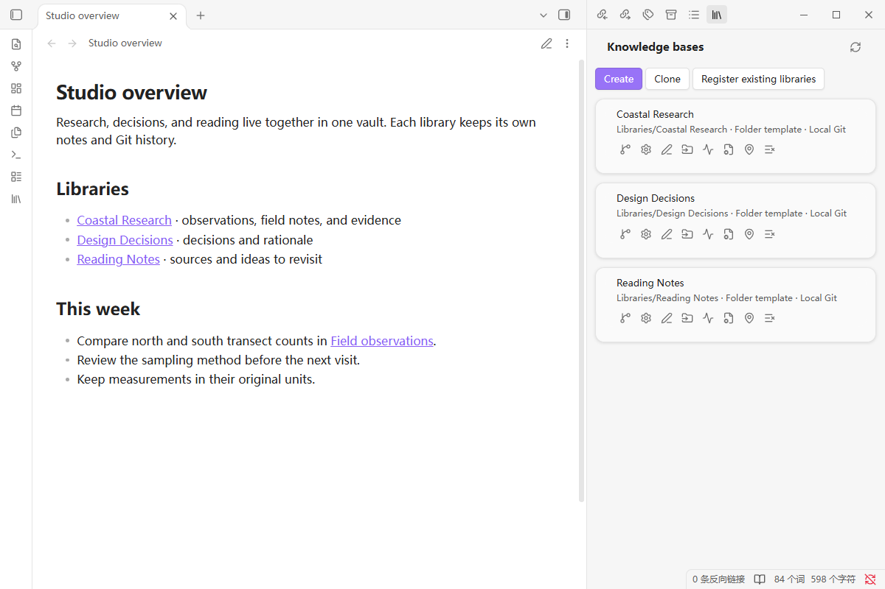](docs/screenshots/01-libraries-overview.png) | [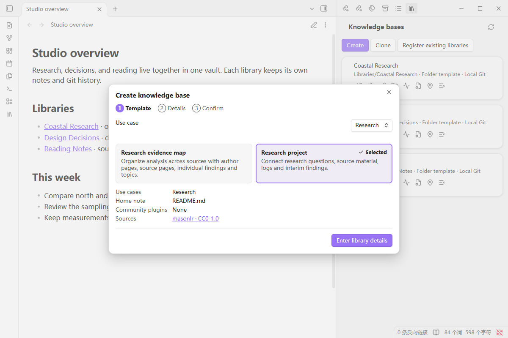](docs/screenshots/02-choose-research-template.png) |

1. 选择用途和模板，再点 **填写知识库信息**。
2. 选择父目录（也可选 Vault 根目录）并填写新目录名。在 **高级 Git 选项** 核对将写入提交记录的姓名和邮箱。只在本地工作时，远端地址可留空。
3. 点 **预览**，核对目标路径、首提交和要从 Obsidian 搜索与图谱中隐藏的目录。排除目录也可能让其中的笔记从 Bases 视图消失。Kepano 默认显示 `Templates`，建好后即可浏览模板视图。如果检验排除配置指向不存在的文件或目录，预览也会标出路径。
4. 点 **创建知识库**。采用默认设置时，Git 会在 `main` 分支生成 `Initial commit`，其中包含库内离线检验工具。点 **运行首次检验** 即可查看结果。[建库示例](docs/getting-started.md)

| 填写目录、显示名和 Git 署名 | 创建前核对目标与搜索排除项 |
| --- | --- |
| [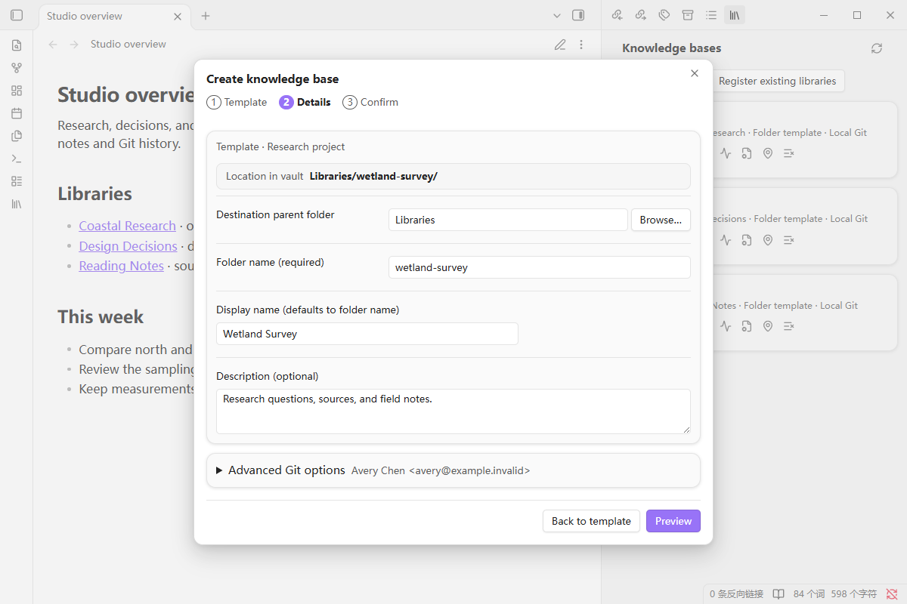](docs/screenshots/03-library-details.png) | [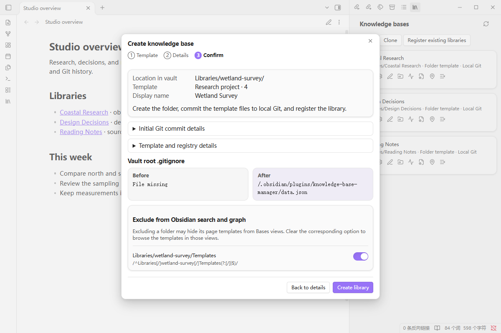](docs/screenshots/04-confirm-library-creation.png) |

点击知识库卡片即可打开该库，鼠标悬停在图标上可查看操作名称。在库内笔记中运行 **插入本库页面模板** 可以预览插入结果，笔记已有的同名属性保留原值。

已有知识库可通过 **登记已有知识库** 选择其 `kb.toml`，或扫描父目录查找清单。远端仓库可用 **克隆** 导入。[登记与恢复](docs/library-lifecycle.md)

### 选择模板

18 套内置模板覆盖 9 类用途。下表列出每套模板的名称、稳定 ID 和专项检验内容。[模板来源与许可](docs/template-catalog.md)

| 用途分类（`purpose`） | 模板一（`id` · 默认专项检查） | 模板二（`id` · 默认专项检查） |
| --- | --- | --- |
| **入门与日常**（`starter`） | **首周笔记**（`minimal-first-week` · 日记入口与日期） | **日记与知识札记**（`minimal-journal` · 札记归档年份） |
| **资料与收藏**（`collections`） | **Kepano（含示例）**（`kepano` · 分类链接） | **媒体体验记录**（`media-tracker` · 媒体进度、评分和完成日期） |
| **课题研究**（`research`） | **课题研究**（`research-project` · 结论证据） | **研究证据图谱**（`research-evidence` · 证据来源类型） |
| **专题阅读**（`reading`） | **卡片盒**（`zettelkasten` · 永久卡来由） | **领域阅读与间隔复习**（`domain-reading` · 复习卡问答） |
| **课程与学习**（`learning`） | **课程学习**（`coursework` · 有效课程和截止日） | **专题备考与错题复做**（`exam-practice` · 掌握状态的复做记录） |
| **工程与经验分享**（`engineering`） | **知识花园**（`knowledge-garden` · 拟分享条目的可见性和私有引用） | **技术雷达**（`technology-radar` · 采用依据与状态） |
| **项目与行动**（`projects`） | **项目推进与周期复盘**（`project-review` · 归档前的未完成任务） | **行动清单与 GTD**（`gtd` · 等待事项位置与跟进日期） |
| **写作与世界观**（`writing`） | **长篇书稿**（`manuscript` · 书稿内章节序号） | **世界观与时间线**（`worldbuilding` · 事件日期与地点） |
| **AI 协作**（`ai-workflows`） | **融合 LLM Wiki**（`llm-wiki` · 知识页索引与分析证据） | **AI 协作工作记忆**（`ai-worklog` · 决策取代关系） |

例如，知识花园会提醒你检查标为拟分享的私有笔记。世界观模板能指出 `2026-02-30` 这样的无效公历日期，也允许使用架空纪年。你还可以登记自己的目录模板，或制作能通过 `kb-template.json` 声明变量、受管文件和专项检验的模板。[模板制作指南](docs/template-authoring.md)

## 单库 Git 工作流与历史提交图

在知识库卡片上打开 **Git 工作区**。进入 **更改**，点击文件查看差异，可暂存整个文件或单个差异块。如果暂存后又修改了同一文件，提交已暂存内容只会保存先前暂存的版本。即使没配置远端，也可以先在本地提交。[逐库 Git、凭据与自动化](docs/library-git.md)

| 分别查看已暂存与工作区改动 | 并排查看工作区的逐行差异 |
| --- | --- |
| [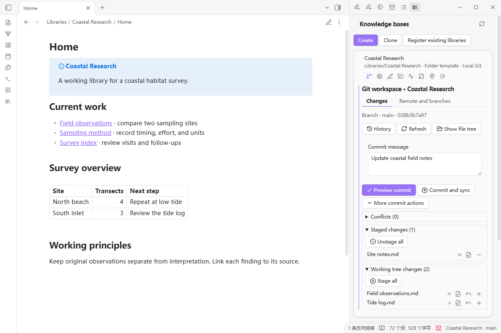](docs/screenshots/05-git-workspace.png) | [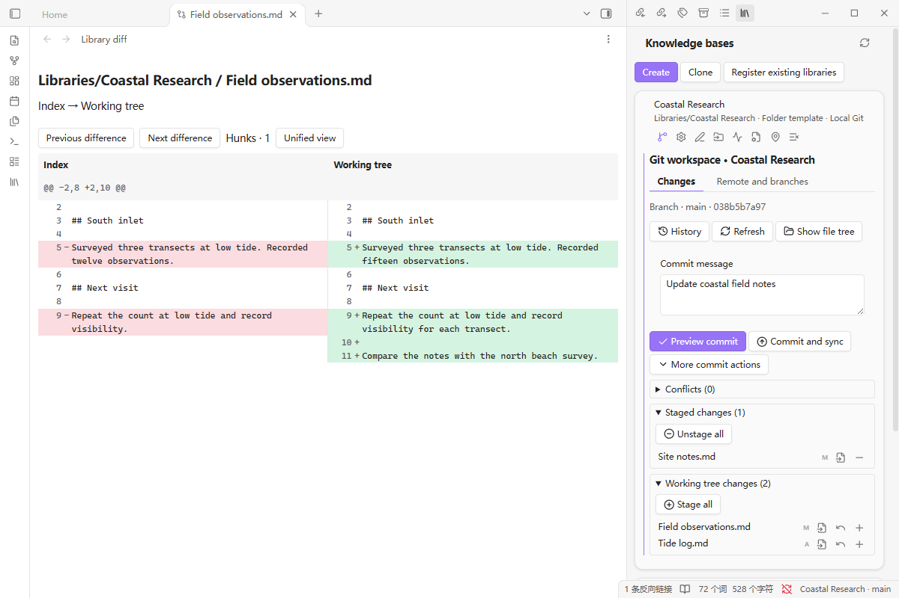](docs/screenshots/06-working-tree-diff.png) |

提交预览列出本次将提交的文件，图中只有 `Site notes.md` 已暂存。在本库的 Git 设置中，可以指定暂存区为空时是否自动暂存，并为以后的提交设置说明模板。

| 提交前核对已暂存文件 | 配置当前库的提交选项 |
| --- | --- |
| [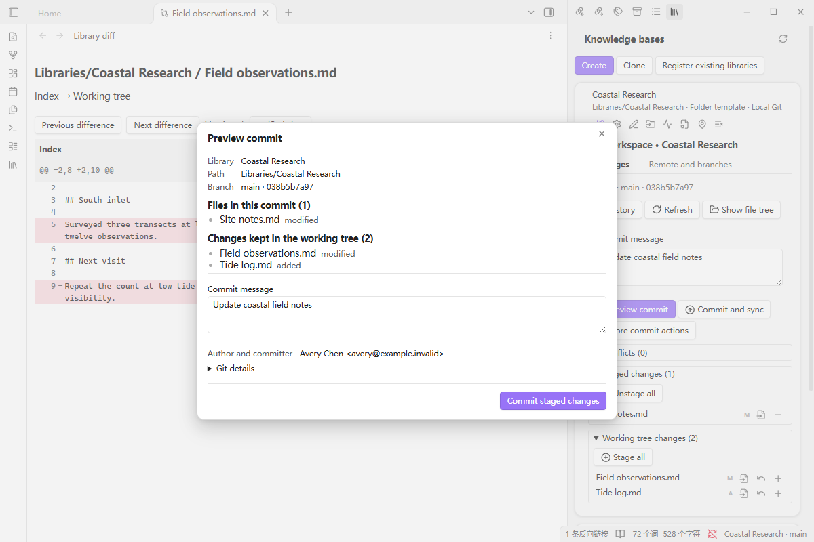](docs/screenshots/07-review-staged-commit.png) | [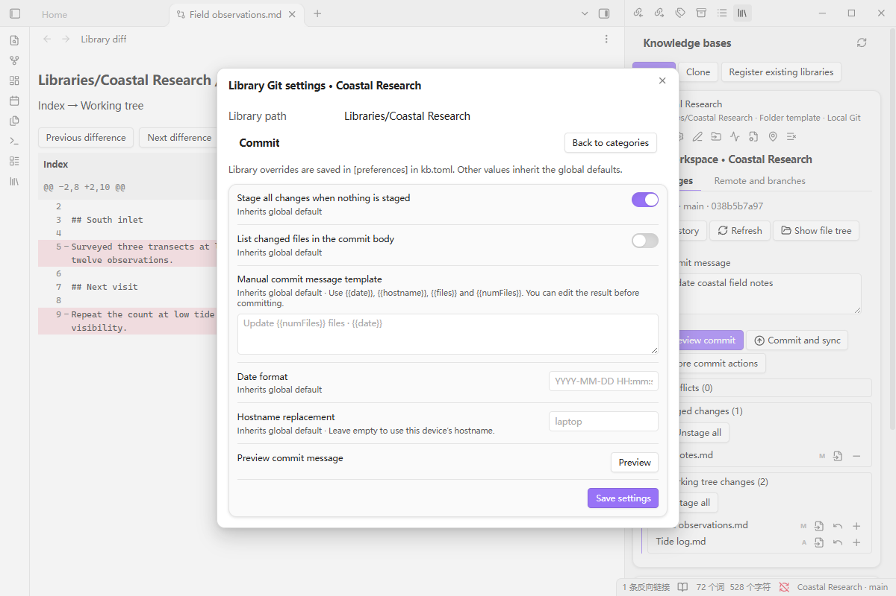](docs/screenshots/08-library-commit-settings.png) |

打开 **历史** 并点击一条提交，默认在**该行下方**展开提交信息和变更文件。合并提交默认与第一父提交比较，也可改选其他父提交。点击文件可查看红绿标记的逐行差异，并切换双栏或统一视图。

| 浏览分支与合并提交历史 | 在行内展开提交说明与变更文件 |
| --- | --- |
| [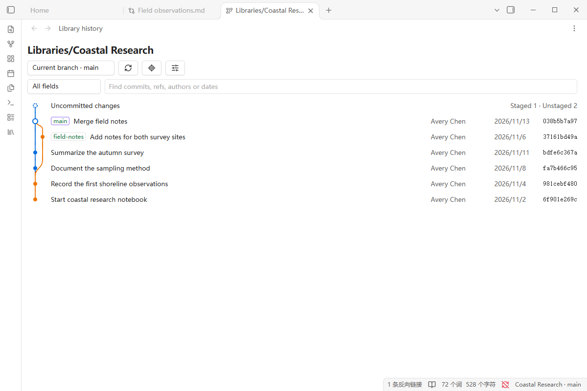](docs/screenshots/15-history-graph.png) | [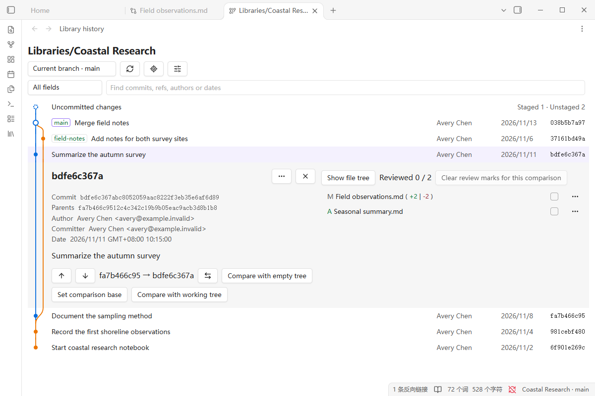](docs/screenshots/16-inline-commit-details.png) |

比较两条提交时，先点一条，再按住 **Ctrl** 点击另一条（macOS 用 **Cmd**）。面板留在第一次点击的行下，默认从图中靠下的提交比较到靠上的提交。点 **交换比较方向** 可反向查看。按住同一修饰键点击第三条可更换比较对象，再点第二条则回到单提交详情。向下滚动会加载更早的提交，Ctrl/Cmd+F 可查找提交。[历史图操作](docs/git-graph-compatibility.md)

| 比较选中的两次提交 | 查看两次提交间的逐行差异 |
| --- | --- |
| [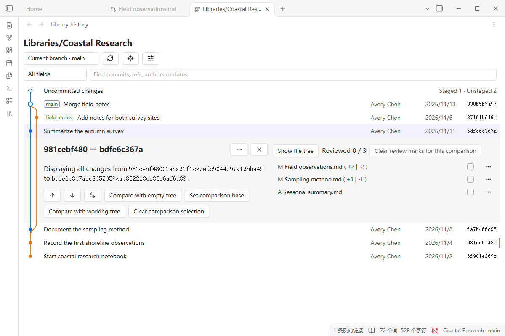](docs/screenshots/17-compare-two-commits.png) | [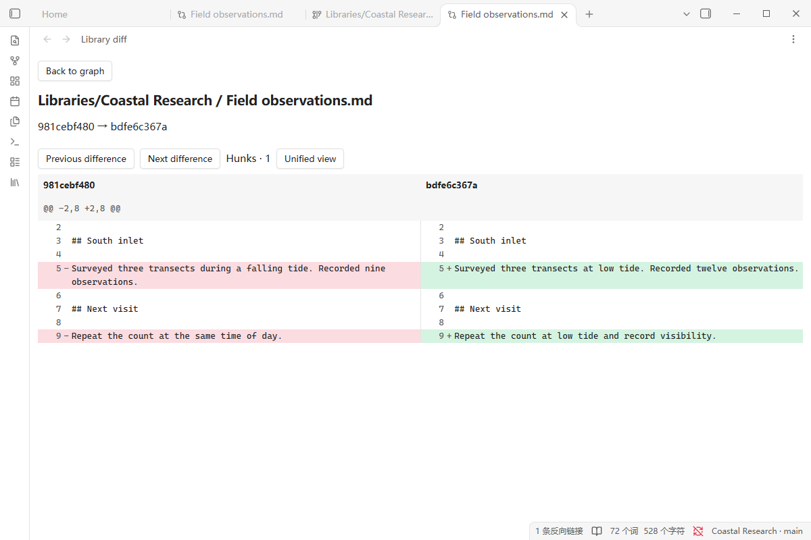](docs/screenshots/18-compare-commits-line-diff.png) |

## 知识库检验与离线 CLI

在知识库卡片点 **检验 → 开始检验**，运行通用规则和模板专项。想了解单独搬走这个库会遗漏哪些依赖，可选 **自选检查项 → 可移植性**。桌面端使用 Obsidian 实际打开的链接目标。同名候选默认在本库和其他已登记库中查找，也可扩大到整个 Vault。

| 自选检查项与可移植性 | 查看已检、跳过与未验证的数量 |
| --- | --- |
| [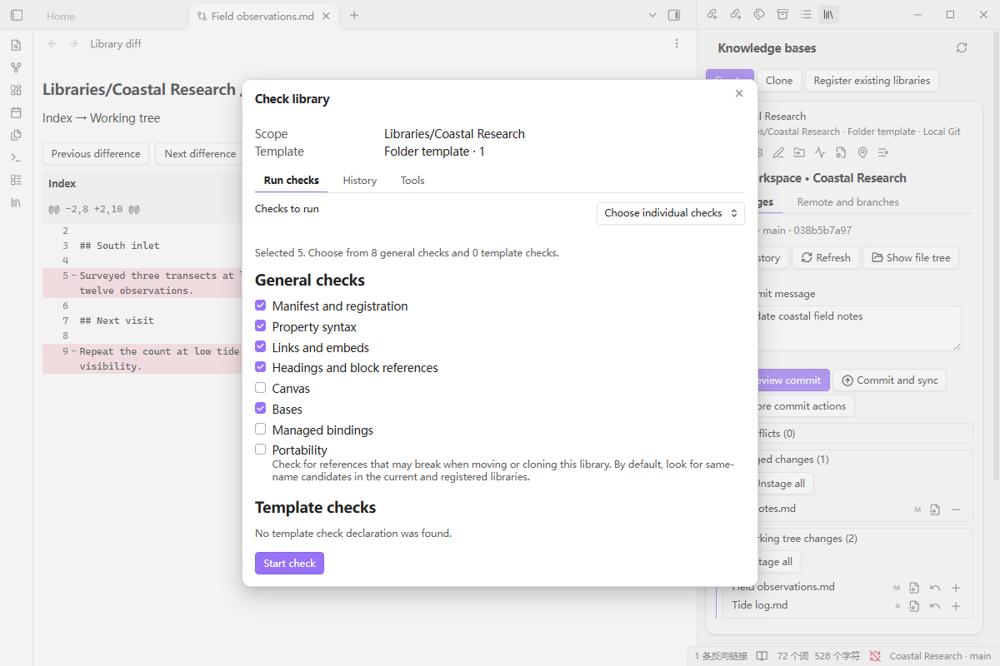](docs/screenshots/09-choose-diagnostic-checks.png) | [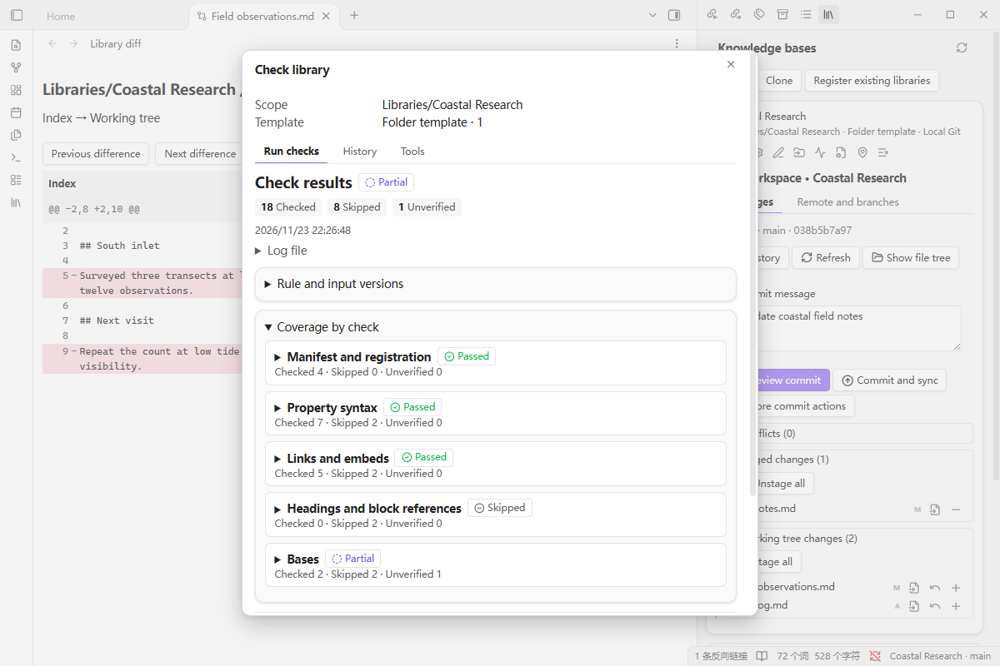](docs/screenshots/10-diagnostic-summary.png) |

在 **各项检查范围** 中展开 **Bases**，可查看已检、跳过或未验证的文件和筛选条件。下图中，点击 `Views/Survey.base` 第 4 行，即可在源码中看到已检的目录筛选 `file.inFolder("Libraries/Coastal Research")`。即使 Base 的 YAML 结构正确，动态筛选的结果仍可能需要在 Obsidian 中打开视图核对。因此，报告显示 `partial` 时，发现的问题数可以为零。

| 展开 Bases 查看已检的目录筛选 | 定位到 Survey.base 第 4 行 |
| --- | --- |
| [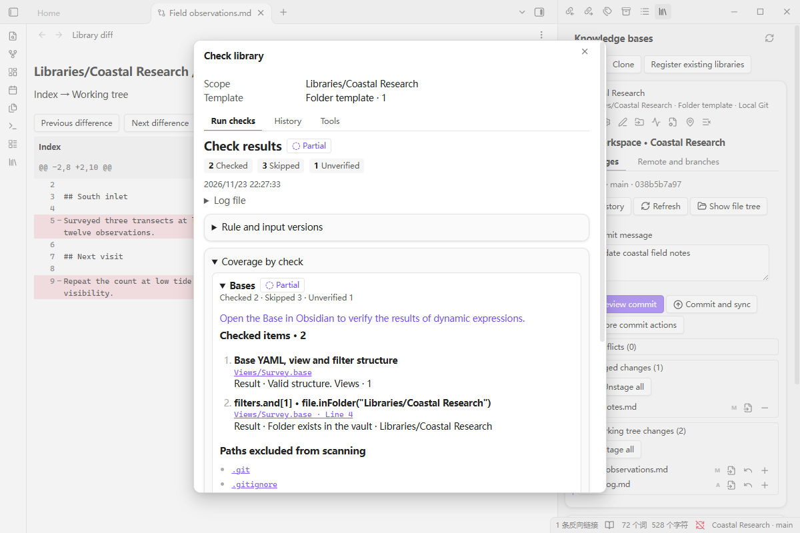](docs/screenshots/11-diagnostic-file-details.png) | [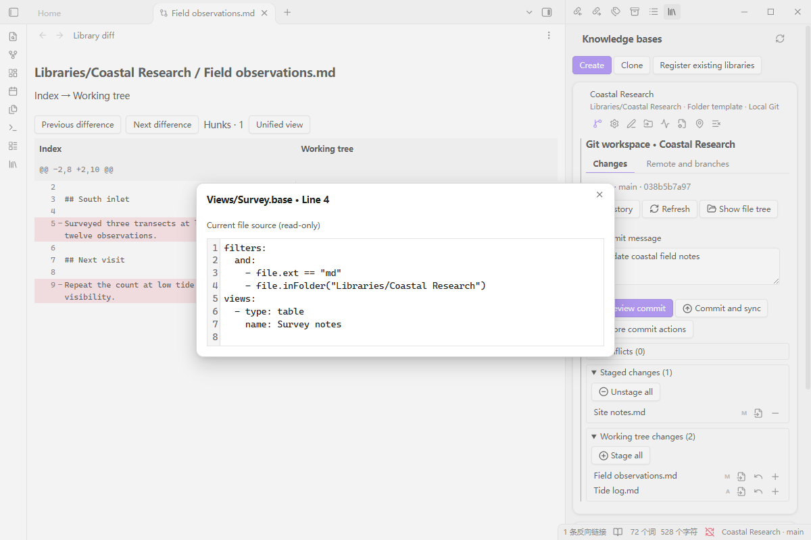](docs/screenshots/12-diagnostic-source-location.png) |

模板作者可在 `kb-template.json` 的 `diagnosticExclusions` 中按源文件或目录跳过指定检查。其他笔记**指向**被排除文件的链接仍会检验。Obsidian 搜索与图谱的排除目录需要单独设置。

新库自带 `checks/kb-check.cjs` 和 `checks/common/` 下的可编辑规则。在 **检验工具 → 查看版本与差异** 中可更新符合条件的文件，自己改过的文件会列出供人工合并。已有 Kepano 库还能逐个更新 `Attachments.base` 和 `Everything.base`。个人或改过的规则使用前，点 **审查脚本** 检查源码，授权当前 SHA-256 摘要；再次修改后需重新授权。没有运行器的旧库可从 **检验工具** 导出。

装好 Node.js 后，在知识库根目录执行以下命令。关闭 Obsidian 也可以运行。

```sh
node ./checks/kb-check.cjs --library . --list
node ./checks/kb-check.cjs --library . --checks all
```

`--checks all` 运行常规与模板专项。单查可移植性可用 `--checks portability`，并用 `--vault-root` 指定实际 Vault 路径。离线时缺少解析证据的短链接会列为未验证。CLI 输出 JSON，并把报告保存在 `.log/`。即使退出码为 0，也应同时读取 `status`、各检查项的 `coverage` 和 `diagnostics`。[检验、退出码与日志格式](docs/diagnostics.md)

## 移动或重命名知识库

在知识库卡片点 **移动**，选择目标并预览变更。只想改目录名时，保留当前父目录，填写新名称。

预览列出受影响的入链，以及独立或内嵌 Base 中可识别的路径筛选，包括你后来新建的视图。右图是确认前的预览，可核对拟用的新名称，并选择要随之更新的 Base 路径。如果 `[[../课程索引]]` 移动后仍会打开同一个文件，就不会出现在预览里。确认前可核对目标不明确的链接、尚未保存的编辑和库外改动。移动若中断，可复核并继续。[迁移与恢复](docs/library-lifecycle.md)

| 选择移动或重命名目标 | 确认前核对入链与 Base 路径 |
| --- | --- |
| [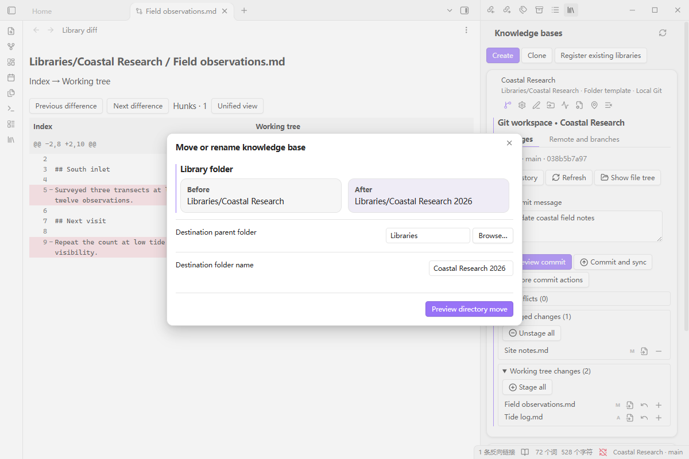](docs/screenshots/13-move-destination.png) | [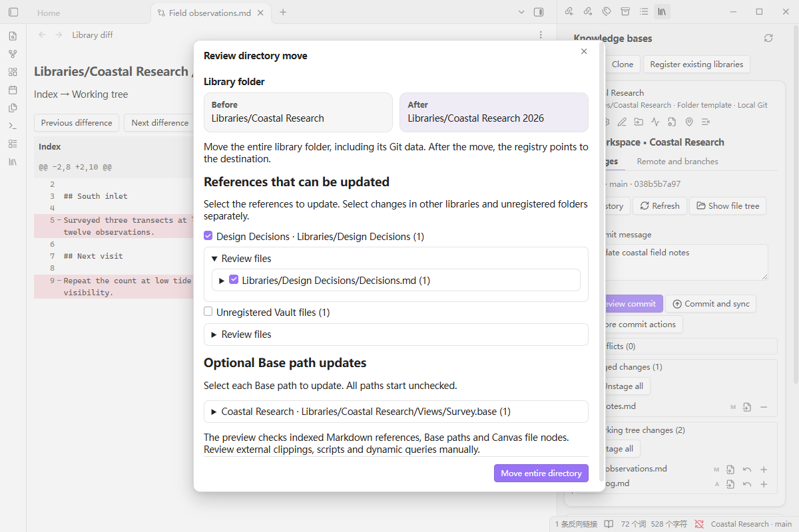](docs/screenshots/14-review-move-and-references.png) |

## 设置存储与隐私边界

| 位置或能力 | 保存或访问的内容 |
| --- | --- |
| 插件 `data.json` | 保存语言、默认 Git 偏好和已登记库的 Vault 相对路径。公开 Vault 配置前可检查此文件是否已被 Git 跟踪。 |
| 知识库与设备设置 | `kb.toml` 保存库的 UUID、模板和逐库偏好，本库 Git 默认忽略它，搬库时应随目录保留。Git 署名和远端存在 `.git/config`。收藏、脚本授权、自动化授权和移动恢复记录保存在本设备上。可选的 HTTPS 备用凭据使用 Obsidian SecretStorage。 |
| 本地文件与进程 | 桌面插件通过文件系统接口管理知识库、读取 Git 元数据及保存日志。移动预览会检查 Vault 路径以查找受影响的入链。仓库操作调用系统 Git，SSH 远端可使用 OpenSSH。已授权的自定义检验和模板专项在本地 Node.js 进程中运行，拥有当前系统账号的文件与网络权限。 |
| 网络与剪贴板 | 克隆、获取、拉取和推送会访问所选远端。推送会发送提交及署名，自动同步需按库授权。在 Git 历史中使用复制操作时，才会把选中的 SHA、标题、引用名或路径写入剪贴板。 |

## 构建、验证与开发指南

在仓库根目录使用 Node.js 24、npm、系统 Git 与 Python 3：

```sh
npm ci
npm run typecheck
npm run lint
npm test
npm run build
node scripts/verify-mobile.mjs
python scripts/package_plugin.py
```

构建生成 `main.js` 和 `dist/kb-check.cjs`。打包脚本核对依赖及许可，并生成包含插件、CLI 和许可声明的 `dist/knowledge-base-manager.zip`。GitHub Release 分别提供三个插件文件。CI 在 Windows、macOS 和 Ubuntu 上验证构建。

详细指南

- [安装与创建第一个知识库](docs/getting-started.md)
- [在侧栏管理本库 Git](docs/library-git.md)
- [桌面历史图与 Git Graph 的功能对照](docs/git-graph-compatibility.md)
- [Obsidian Git 移植对照](docs/git-compatibility.md)
- [接管、迁移和恢复知识库](docs/library-lifecycle.md)
- [运行和解读知识库检验](docs/diagnostics.md)
- [内置知识库模板目录](docs/template-catalog.md)
- [制作可实例化的知识库模板](docs/template-authoring.md)
- [构建、验证与平台支持](docs/development.md)

<details>
<summary>仓库源码结构与架构导览</summary>

```text
obsidian-kb-manager/
├── manifest.json / versions.json / package.json / tsconfig.json / styles.css
├── esbuild.config.mjs               # 双目标构建：插件 main.js + 独立离线诊断 CLI dist/kb-check.cjs
├── src/
│   ├── main.ts                      # 桌面端插件生命周期、按库互斥锁、命令与视图注册
│   ├── settings.ts / preferences.ts / i18n.ts
│   ├── kb/                          # 目录扫描发现、kb.toml 身份解析、建库/克隆/可恢复移动、绑定维护与检验工具更新
│   ├── git/                         # 按库隔离的原生 Git 与 isomorphic-git 服务、历史提交图、行作者、差异块与同步
│   ├── diagnostics/                 # 共享诊断引擎、随版内置/Node 通用规则、模板专项执行与 CLI 入口 (cli.ts)
│   ├── fs/ & registry/              # Vault 路径安全边界、原子写入、data.json 登记表与目录扫描
│   ├── ui/                          # 侧边栏管理器、建库/克隆/模板向导、Git 工作区/历史图/差异标签页、检验与脚本审查弹窗
│   └── mobile/                      # 按 Platform.isMobile 分流的移动端兼容入口（由 verify-mobile.mjs 校验，当前清单桌面独占）
├── assets/
│   ├── checks/common/*.mjs          # 随新库分发的 8 项通用规则（manifest、properties、links、anchors、canvas、bases、bindings、portability）
│   ├── templates/<purpose>/<id>/    # 9 类用途共 18 套内置模板（kb-template.json、checks/*.mjs、LICENSES.md）
│   └── licenses/obsidian-git.txt    # 上游 Obsidian Git MIT 许可原文
├── scripts/                         # template-catalog.mjs、build-check-kit.mjs、prepare-test-kit.mjs、verify-mobile.mjs、package_plugin.py
├── tests/                           # Node test runner 自动化测试套件 (*.test.mjs) 与隔离夹具
├── docs/                            # 操作指南、兼容性对照、检验判读、模板开发与构建验证文档
└── .github/workflows/               # 三平台 CI 校验 (lint.yml) 与带构建证明的 Tag 草稿发布流 (release.yml)
```

</details>

## 许可与致谢

Knowledge Base Manager 采用 [0BSD 许可证](LICENSE) 开源。其 Git 界面包含改编自 [Obsidian Git 2.43.0](https://github.com/Vinzent03/obsidian-git) 的代码，遵循 [MIT 许可证](assets/licenses/obsidian-git.txt)。内置 18 套知识库模板分别致谢各自上游作者并保留上游源码引用与许可声明，详见[内置模板目录](docs/template-catalog.md)及离线发行包中的 `THIRD_PARTY_NOTICES.md`。
